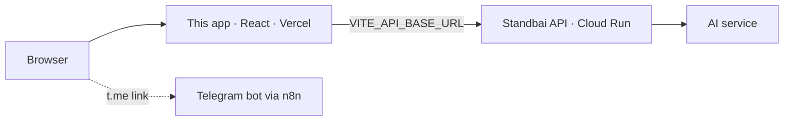

# MEMORY: Standbai Web App (`FE-FORGEHACK-2026`)

> ## Language rule (read first)
> **Always use English** in this repository: UI copy, alt text, ARIA labels, code, comments, docs, commit messages, design deliverables and every explanation written by an AI assistant. ForgeHacks is an international hackathon judged in English.
> Allowed exceptions: the optional Indonesian (ID) UI dictionary `src/i18n/id.ts`; stable data slugs from the API (e.g. `hutan_sebangau`); proper nouns (places; agencies such as BMKG, PVMBG, BPBD); official Indonesian terms shown with an English gloss (e.g. "Unhealthy (Tidak Sehat)", "Level III, Siaga (Watch)").

Shared memory for people and coding agents working on the frontend. Keep **Progress** and the **Decision log** current. Tasks live in [`PRD.md`](PRD.md).

---

## 1. Competition essentials
- **ForgeHacks Online 2026**, track **AI + Climate**: "Build an AI-powered solution that helps people understand environmental changes, prepare for climate impacts, use resources wisely, or create resilient systems."
- **Submission locks Sat Oct 10, 12:00 PM ET = 23:00 WIB.** Feature freeze 18:00 WIB.
- **Submit:** description, track, 2–4 min public video, GitHub repo with a clear README, written description, screenshots or a **live link**.
- **Judging:** five criteria, 20% each: impact · technical & AI use · innovation · **execution & completeness** · **presentation**. The frontend carries the live demo and the video.
- **Rules:** build during the event; use AI honestly ("be clear about what you built, what you used, and what actually runs"); judges test what we submit. "A half-working project is okay. Overstating it isn't."

## 2. Product
- **Standbai:** *Know where the smoke is heading before it reaches home.* It watches forest fires and volcanoes across Indonesia, forecasts where smoke and ash will go, and turns that into a household plan. Alerts also go out on **Telegram**.
- **Users:** parents, carers, teachers and health workers in haze- and ash-prone towns. Design for them, not for scientists.
- **Design source of truth:** [`docs/design/reference-prototype.html`](docs/design/reference-prototype.html). It has five views: Home scroll story, Dashboard, Map, Why, Ready. Tokens, copy and behaviour come from it. The illustrated-landing references are `docs/design/reference-landing-{1,2,3}.png`.
- **Honesty in the UI:**
  - one yellow **AI** badge on every model-made value;
  - an "Example data" badge whenever real data isn't connected;
  - the disclaimer "Not an official warning. Follow BMKG, PVMBG and your local BPBD." on results.

## 3. Architecture

- The web app calls **only** the backend. Contracts: `PRD.md` §5 (shared with the backend PRD).
- Routes:
  - `/` Home;
  - `/dashboard?city=`;
  - `/map`;
  - `/why?city=`;
  - `/ready?city=`;
  - `/simulate` (the existing Leaflet expert dashboard);
  - `/history` (P1).

## 4. People
| Person | Role |
|---|---|
| **Ziddan Habibie** | Frontend owner (this repo) |
| Hikari Reiziq | Backend API, deploy, Telegram/n8n: ask for the API URL and the bot link |
| Arya Bisma | Backend engine, fires, volcanoes, map frames |
| Arkan Zahir | AI: outlook model, chat |

## 5. Progress (verified on `main` `9e094db`, 2026-10-10)
- **Working:**
  - Leaflet expert dashboard (header, controller dock, map layers, 48 h timeline, five analysis tabs, legend, geolocation);
  - mostly English UI; `lang="en"`; `public/Logo.png`.
- **Known problems** (tickets in `PRD.md`):
  - API base hard-coded to `127.0.0.1:8000` (FE-03);
  - CSS "3D POV" tilt breaks map clicks (FE-10);
  - title says "StandbAI" (FE-03);
  - ~30 Indonesian lines and 3 old-name comments left (FE-03);
  - no router or landing (FE-01, FE-04).
- **Next:** the PRD task board, FE-01 → FE-14 (P0), then FE-15/16 (P1).

## 6. Conventions
- **Stack:** React 19 function components, TypeScript strict, Vite 8, Tailwind v4 for layout glue, prototype CSS tokens for all colours, `oxlint`.
- **Config:** `VITE_API_BASE_URL`, `VITE_TELEGRAM_BOT_URL`. Never put API keys in the frontend.
- **Time and units:** the backend sends UTC; show local time with a zone label (WIB/WITA/WIT); µg/m³ for concentrations.
- **ISPU:** codes `good … hazardous`, breakpoints 15.5 / 55.4 / 150.4 / 250.4 µg/m³ PM2.5.
- **Accessibility:** WCAG 2.2 AA contrast, visible focus, keyboard-operable controls, `prefers-reduced-motion`, no horizontal scroll at 390 px.
- **Performance:** lazy routes; Leaflet only on `/simulate`; no image over 200 KB after the optimizer.
- **Map attribution must always be visible:** "© OpenStreetMap contributors" for OSM tiles; "Tiles © Esri — Source: Esri, Maxar, Earthstar Geographics" for imagery; a credit line for the prototype map outline.
- **Git:** branches `feat/…`, `fix/…`, `docs/…`. Commits follow Conventional Commits in English (`feat(dashboard): …`). Pull before pushing.

## 7. Decision log
| Date | Decision | Why |
|---|---|---|
| 2026-10-09 | Product name **Standbai**; English UI | International judging |
| 2026-10-09 | Deploy on Vercel; backend on Cloud Run | Free and fast; no sponsor hosting before the deadline |
| 2026-10-10 | The prototype `docs/design/reference-prototype.html` wins over older design notes; EN default, ID toggle allowed | Finished design; residents are Indonesian, judges read English |
| 2026-10-10 | Port the prototype's own scroll, SVG and canvas code; no GSAP, chart or state libraries | Small, already works, fewer dependencies |
| 2026-10-10 | Keep the Leaflet dashboard as `/simulate` | Preserve the expert simulation view |
| 2026-10-10 | Image optimizer (`vite-plugin-image-optimizer`, WebP/AVIF) | Large images must ship small |
| 2026-10-10 | Chat is optional (P1); the same `/chat` serves web and Telegram | Focus on the core first |
| 2026-10-10 | Claude Design only for screens the prototype lacks (History, chat, `/simulate` re-skin) | Avoid redesigning finished views |

## 8. Links
- Backend: https://github.com/ITHACKITS/BE-FORGEHACK-2026 · AI: https://github.com/ITHACKITS/AI-FORGEHACK-2026
- Devpost: https://forgehacks-2026.devpost.com · ForgeHacks: https://forgehacks.dev
- Live URL: *add the Vercel URL after FE-11.* · Telegram bot: *add after BE-11.*
