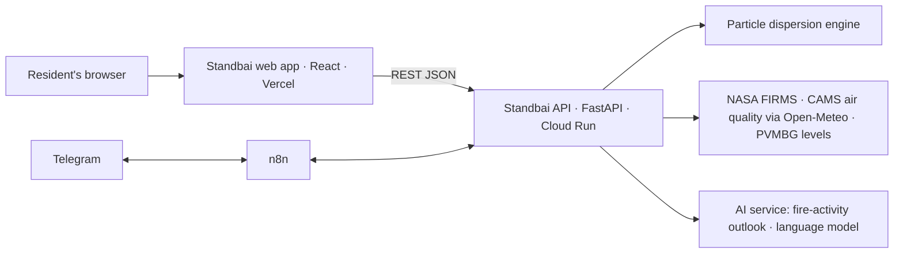

# Standbai: Web App

**Know where the smoke is heading before it reaches home.**

Standbai watches forest fires and volcanoes across Indonesia, forecasts where the smoke and ash will travel, and tells each household what to prepare before it arrives.

*ForgeHacks Online 2026 · AI + Climate track*

| | |
|---|---|
| Live app | *Vercel URL: added at submission* |
| Demo video | *YouTube link: added at submission* |
| Telegram alerts | *t.me link: added at submission* |
| Backend API | [BE-FORGEHACK-2026](https://github.com/ITHACKITS/BE-FORGEHACK-2026) |
| AI service | [AI-FORGEHACK-2026](https://github.com/ITHACKITS/AI-FORGEHACK-2026) |

---

## The problem

Every dry season, smoke from forest and peat fires in Sumatra and Kalimantan drifts across cities, and eruptions such as Merapi, Semeru or Lewotobi spread ash over nearby towns. The data exists: NASA FIRMS fire hotspots, PVMBG volcano levels, air-quality readings. But it's scattered across agencies, written for experts, and rarely answers what families need to know:

- **Will the smoke reach my town?**
- **When will it arrive?**
- **What should I prepare?**

Most people find out when the sky has already changed colour.

## What the web app does

| Page | What a resident gets |
|---|---|
| **Home** `/` | An illustrated story: a village at the foot of a volcano goes from a clear day, to fire and haze with a Standbai notification, to a prepared community |
| **Dashboard** `/dashboard?city=` | The air right now in plain words, the next three days, a PM2.5 chart from three days ago to three days ahead with ISPU colour bands, and an **AI outlook** for 3 days, 2 weeks, a month and the nearest volcano |
| **Map** `/map` | Indonesia then, now and next: slide from seven days ago to three days ahead; smoke, fire hotspots, volcanoes and wind |
| **Why** `/why?city=` | Why the AI says so: the signals it read, confidence, limits, and links to every original source |
| **Ready** `/ready?city=` | A household checklist (N95 masks, water, medicine, a clean room, a go bag) sized to the household and the number of bad-air days |
| **Simulate** `/simulate` | The expert view: run a volcanic-ash or wildfire-smoke simulation and see probability tiers (≥90/50/5%), arrival times and impacts on schools, health facilities and airports |
| **Telegram** | Subscribe to a city: daily outlook and an alert when the outlook turns High |

Every AI-made value carries the same yellow **AI** badge. Standbai is **not an official warning**: follow BMKG, PVMBG and your local BPBD.

## Status

The **Status** column is updated at submission time to what actually runs.

| Feature | Status |
|---|---|
| Expert simulation dashboard (Leaflet, plume tiers, impact tabs) | Working |
| Home scroll story, Dashboard, Map, Why, Ready (ported from the design prototype) | In progress |
| Real data on all pages (falls back to labelled example data) | In progress |
| Telegram subscription and alerts | In progress (backend + n8n) |
| Ask Standbai chat panel | Planned (optional) |
| Past events with news (Merapi 2010, 2019 haze) | Planned |

## How it works

- **Stack:** React 19, TypeScript, Vite 8, Tailwind CSS v4, React Router, Leaflet (expert view only).
- **Data access:** the app talks only to the Standbai API through `VITE_API_BASE_URL`; no keys live in the browser.
- **Fallbacks:** when an endpoint isn't available, the page shows example data with a visible "Example data" badge.
- **Accessibility and performance:**
  - light and dark themes;
  - `prefers-reduced-motion` support;
  - keyboard-friendly controls;
  - images optimised to WebP/AVIF at build time.

## Data sources and credits

| Source | Used for |
|---|---|
| NASA FIRMS (VIIRS, MODIS) | Fire hotspots |
| CAMS global forecasts via the Open-Meteo Air Quality API | PM2.5, PM10, dust |
| Open-Meteo | Wind and rain |
| PVMBG / MAGMA Indonesia | Volcano alert levels |
| ISPU (Indonesia's air-quality index, KLHK) | Category thresholds |
| OpenStreetMap contributors; Esri World Imagery | Map tiles on `/simulate` |

Full catalogue and licences: [backend `docs/DATASETS.md`](https://github.com/ITHACKITS/BE-FORGEHACK-2026/blob/main/docs/DATASETS.md).

## Limitations

- **Forecasts are estimates.** Air-quality categories from forecast data are indicative; official ISPU uses 24-hour station averages.
- **No eruption timing.** The AI doesn't predict *when* a volcano erupts; it reads the PVMBG status and simulates where ash would go.
- **Missed fires.** Fires that satellites haven't detected yet aren't counted.
- **Coarse long range.** Two-week and one-month outlooks are coarser than the three-day forecast.

## Documentation

| File | Purpose |
|---|---|
| [`SETUP.md`](SETUP.md) | Install, run, build, deploy |
| [`PRD.md`](PRD.md) | Product requirements and the task board |
| [`MEMORY.md`](MEMORY.md) | Context, conventions and decision log (start here if you're new) |
| [`docs/design/reference-prototype.html`](docs/design/reference-prototype.html) | Design source of truth (open it in a browser) |
| [`docs/design/`](docs/design/) | Reference images for the illustrated landing |

## Team

| Person | Role |
|---|---|
| Ziddan Habibie | Frontend |
| Hikari Reiziq | Backend API and platform |
| Arya Bisma | Backend engine and data |
| Arkan Zahir | AI |
